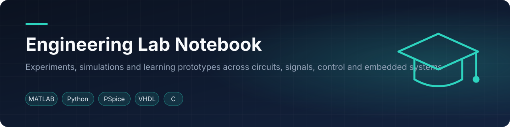

    

<a href="#english">English</a> · <a href="#español">Español</a>

## English

### Overview

This is a lab notebook of experiments, simulations and learning prototypes developed during Elías Álvarez's electronics-engineering studies. It collects compact work that demonstrates a result, a design method, a calculation or a working program. Finished projects live in their own repositories under [simplementeUnPorito](https://github.com/simplementeUnPorito); this repository preserves the smaller investigations that support that broader body of work.

### Contents

| Topic | Items | Scope |
|---|---:|---|
| [Circuits](circuits/README.md) | 9 | Analog, feedback, tolerance and power-conversion simulations |
| [Signals](signals/README.md) | 7 | Convolution, DFT, correlation, interpolation and filter design |
| [Control](control/README.md) | 6 | PID, compensators, frequency response and sampled-data behavior |
| [Digital](digital/README.md) | 2 | Small VHDL designs with testbenches and constraints |
| [Embedded](embedded/README.md) | 3 | PSoC C/assembly programs and peripheral experiments |
| [RF & communications](rf-comms/README.md) | 4 | FM and nonlinear-modulation notebooks |
| [Physics](physics/README.md) | 5 | Tracker measurements and compact physical demonstrations |
| [Programming](programming/README.md) | 5 | Self-contained C programs and algorithm exercises |
| [Mathematics](math/README.md) | 11 | Transform methods, signal mathematics and calculator utilities |
| **Total** | **52** | |

### Repository layout

Each topic contains a table of items, tools and dates. Every item is a self-contained folder containing the smallest useful source set; selected `fig/` directories hold representative results. The em dash in a year column means that the original artifact did not provide a reliable date.

### Opening the files

- Open `.ipynb` files in JupyterLab or Google Colab.
- Run `.m` files in MATLAB; open `.slx` models in Simulink.
- Open `.dsn` schematics with OrCAD Capture and PSpice.
- Build `.cyprj` projects with PSoC Creator 4.x.
- Add the VHDL sources, testbenches and `.xdc` constraints to a Vivado project.
- Open `.trk` files with Tracker Video Analysis.

### License

Source code is released under the [MIT License](LICENSE). Reports, figures and other documentation are shared under [CC BY 4.0](LICENSE-CONTENT.md).

## Español

### Descripción

Este repositorio es un cuaderno de ingeniería con experimentos, simulaciones y prototipos de aprendizaje desarrollados durante los estudios de ingeniería electrónica de Elías Álvarez. Reúne trabajos compactos que muestran un resultado, un método de diseño, un cálculo o un programa funcional. Los proyectos terminados se encuentran en repositorios propios dentro de [simplementeUnPorito](https://github.com/simplementeUnPorito); aquí se conservan las investigaciones más pequeñas que complementan ese trabajo.

### Contenido

| Tema | Elementos | Alcance |
|---|---:|---|
| [Circuitos](circuits/README.md) | 9 | Simulaciones analógicas, realimentadas, de tolerancias y conversión de potencia |
| [Señales](signals/README.md) | 7 | Convolución, DFT, correlación, interpolación y diseño de filtros |
| [Control](control/README.md) | 6 | PID, compensadores, respuesta en frecuencia y sistemas muestreados |
| [Digital](digital/README.md) | 2 | Diseños VHDL pequeños con bancos de prueba y restricciones |
| [Embebidos](embedded/README.md) | 3 | Programas C/assembly para PSoC y pruebas de periféricos |
| [RF y comunicaciones](rf-comms/README.md) | 4 | Cuadernos de FM y modulación no lineal |
| [Física](physics/README.md) | 5 | Mediciones con Tracker y demostraciones físicas compactas |
| [Programación](programming/README.md) | 5 | Programas autocontenidos en C y algoritmos |
| [Matemática](math/README.md) | 11 | Transformadas, matemática de señales y utilidades de calculadora |
| **Total** | **52** | |

### Organización

Cada tema contiene una tabla con sus elementos, herramientas y fechas. Cada elemento ocupa una carpeta autocontenida con el conjunto mínimo de fuentes útil; algunas carpetas `fig/` guardan resultados representativos. Un guion largo en la columna de año indica que el artefacto original no ofrecía una fecha verificable.

### Licencia

El código fuente se distribuye bajo la [Licencia MIT](LICENSE). Los informes, figuras y demás documentación se comparten bajo [CC BY 4.0](LICENSE-CONTENT.md).

