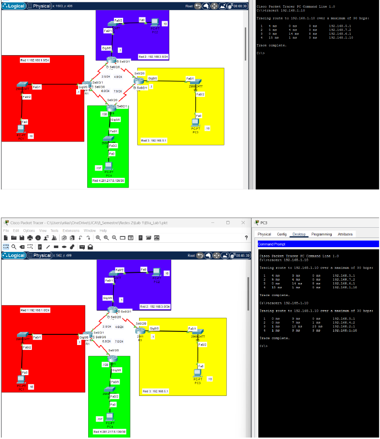

# RIP Routing Failover

<a href="#english">English</a> · <a href="#español">Español</a>

## English

This study configures RIP across a four-router topology in Cisco Packet Tracer. It verifies that traffic follows an alternate path after a serial-link failure.

 <i>Four-router Packet Tracer topology before and after a serial-link failure, with traceroute showing the alternate RIP path.</i>

| What | Tools | Result |
|---|---|---|
| Dynamic routing and link-failure test | Cisco Packet Tracer, RIP | Traceroute followed the alternate RIP path after the link failed |

## Español

Este estudio configura RIP en una topología de cuatro routers en Cisco Packet Tracer. Verifica que el tráfico siga una ruta alternativa después de la falla de un enlace serial.

 <i>Topología de cuatro routers en Packet Tracer antes y después de la falla de un enlace serial, con traceroute mostrando la ruta RIP alternativa.</i>

| Qué muestra | Herramientas | Resultado |
|---|---|---|
| Enrutamiento dinámico y prueba de falla de enlace | Cisco Packet Tracer, RIP | Traceroute siguió la ruta RIP alternativa después de la falla del enlace |
